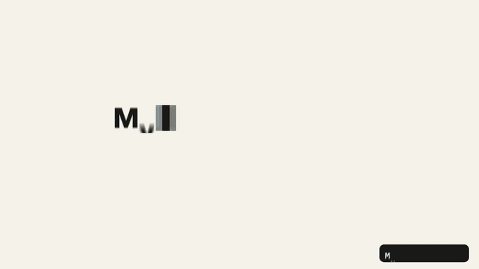
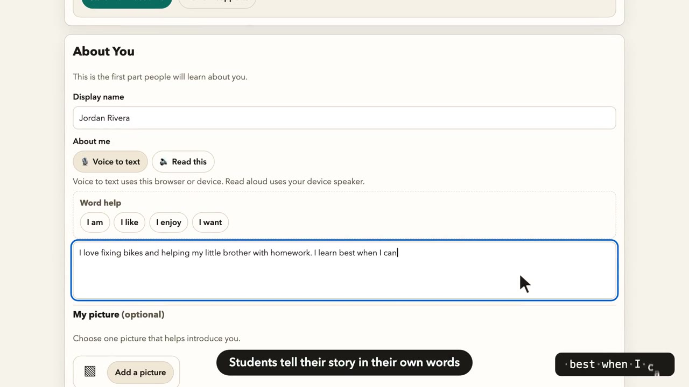
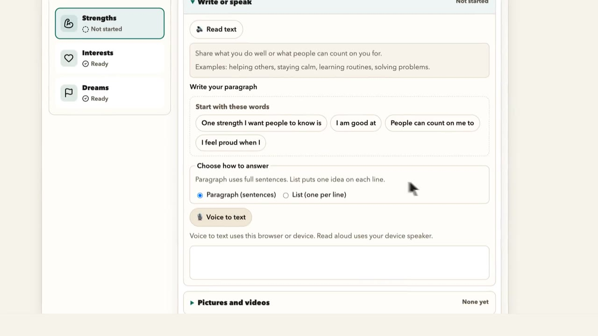
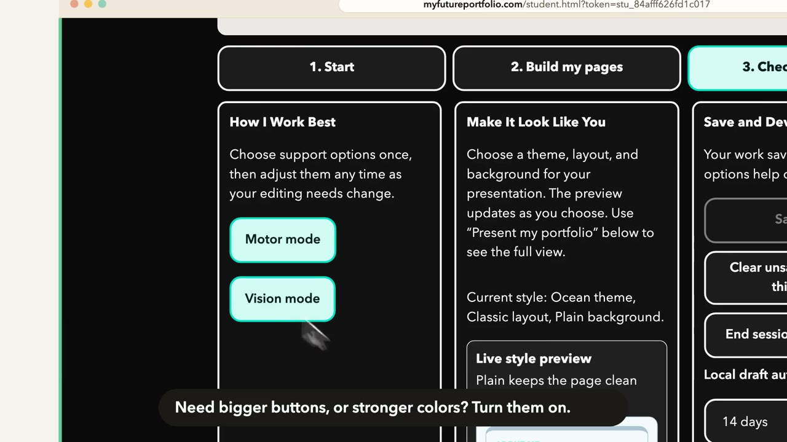
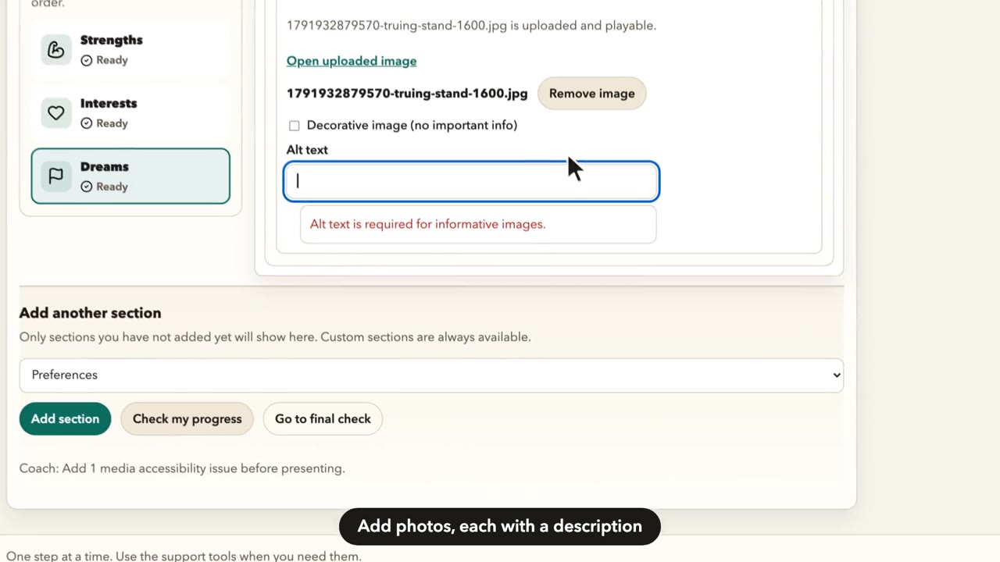
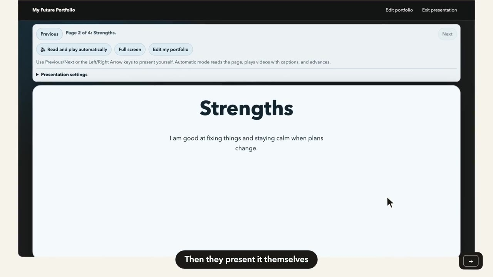
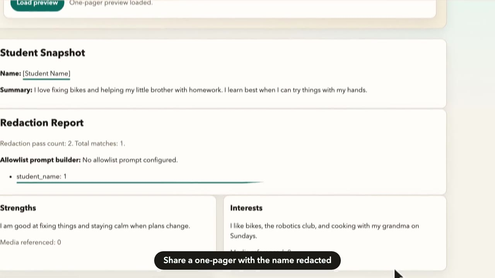

# My Future Portfolio

**Your story. Your voice.**

My Future Portfolio is a student-first portfolio where young people with disabilities document their strengths, interests, preferences, experiences, and goals in their own words, then present them in class, at their IEP meeting, or as a one-page summary. It is built to meet WCAG 2.2 AA.

**[Visit the site](https://myfutureportfolio.com)** · **[Try the demo](https://myfutureportfolio.com/demo)**

*A 40-second tour. Click it to watch the full video.*

## Why I built it

Transition planning is supposed to center the student, but students often sit quietly while adults talk about them. My Future Portfolio gives students a way to lead that conversation, using whatever mix of typing, talking, pictures, and video works for them. Every support is built in from the start, so no student needs a separate "accessible version."

## For students

- **A guided editor** in three steps (Start, Build my pages, Check and finish), so students only work on one small part at a time
- **Read-aloud** on every page, and **voice to text** for students who would rather talk than type
- **Word help** buttons with sentence starters for when a student is stuck
- **Motor mode and Vision mode** for bigger buttons, stronger contrast, and easier navigation
- **Autosave**, so work is never lost
- **Presentation mode** with keyboard navigation, high contrast, larger controls, and automatic read-aloud

## For teachers

- Invite-only teacher accounts, each with their own student roster
- Password-protected edit links for each student
- A **Final Check coach** that explains, in plain language, what to fix before presenting
- A **one-pager** summary with the student's name redacted, downloadable as a Word document

## Accessibility built in

- Images need a description, or must be marked decorative
- Videos need captions or a description
- Tested with automated accessibility checks (axe), plus keyboard, focus, and HTML validation

## Screenshots

| | |
| --- | --- |
|  |  |
| Students tell their story in their own words | Word help when the page is blank |
|  |  |
| Motor and Vision modes, one click away | Every photo gets a description |
|  |  |
| Students present it themselves | A one-pager with the name redacted |

The student shown is fictional demo data. No real student information is used in the site's demos or videos.

## More videos

- [Student tools](https://myfutureportfolio.com/media/videos/student-tools.mp4): a narrated, captioned walkthrough for students
- [Teacher quick start](https://myfutureportfolio.com/media/videos/teacher-quick-start.mp4): setting up an account and adding students

## Interested in using or partnering?

My Future Portfolio is in active development. If you're interested in using it with your students, piloting it in your program, or partnering on it, email [jennifer.burnes@gmail.com](mailto:jennifer.burnes@gmail.com?subject=My%20Future%20Portfolio).

## About

Created by Jennifer Burnes, PhD, a transition specialist working with young adults with disabilities.

The source code is private. Images and text in this repository © 2026 Jennifer Burnes. All rights reserved.
